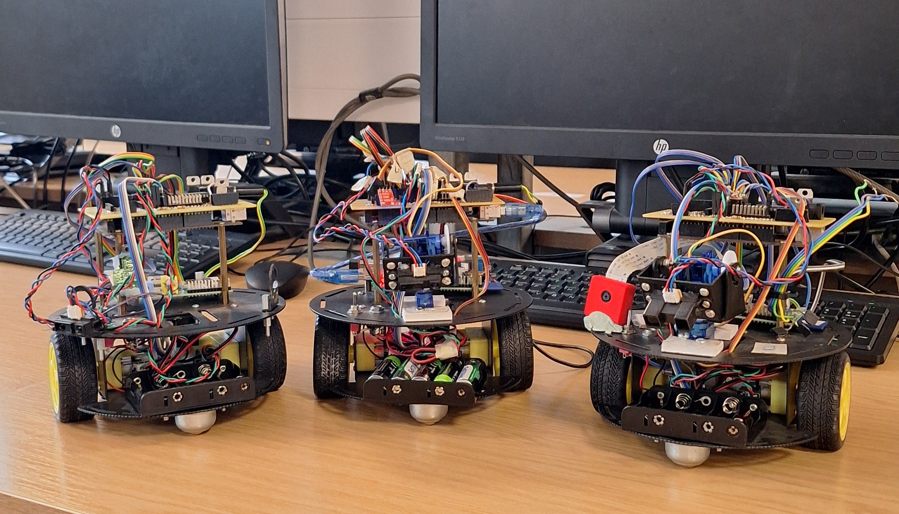

# RAMER – Repair of Autonomous Mobile Educational Robots

Personal engineering initiative at the **University of Aberdeen**.

A fleet of five autonomous mobile educational robots had been unused and faulty since 2013. This project restored **3 of the 5 robots** through hardware troubleshooting, embedded systems work, and documentation.

### Live Project Page
**[→ View the full project page](https://kodokage.github.io/RAMER-Project/)**

---

### Project highlights
- **Platforms:** Arduino Mega + Raspberry Pi
- **Outcome:** 3 robots restored and returned to operation
- **Focus:** Hardware debugging, firmware investigation, system restoration & technical documentation

### Repository contents
| Folder / File | Description |
|---------------|-------------|
| `Docs/` | Project documentation & notes |
| `Arduino_mega_code/` | Arduino firmware |
| `Raspberrypi_code/` | Raspberry Pi / higher-level code |
| `index.html` | Full project page (dark theme) |

---

*Recognising an opportunity, taking initiative, and restoring an educational robotics platform.*
