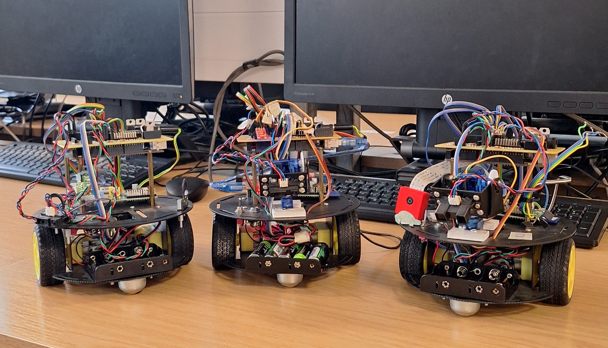
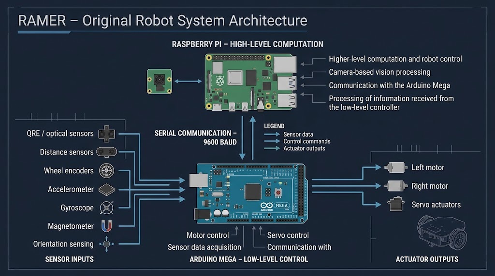

---
layout: default
title: RAMER – Repair of Autonomous Mobile Educational Robots
---

  

  

    

      ENGINEERING PROJECT · UNIVERSITY OF ABERDEEN
    

    <h1 class="ramer-hero-title">RAMER</h1>

    <h2 class="ramer-hero-subtitle">
      Repair of Autonomous Mobile Educational Robots
    </h2>

    

      Recognising an opportunity, taking initiative, and restoring
      an educational robotics platform.
    

  

<nav class="ramer-section-nav" aria-label="Project navigation">
  <a href="#overview">Overview</a>
  <a href="#initiative">Initiative</a>
  <a href="#architecture">Architecture</a>
  <a href="#contributions">Contributions</a>
  <a href="#outcome">Outcome</a>
  <a href="#resources">Resources</a>
</nav>

## Project overview
{: #overview }

RAMER began as a personal initiative during my time at the University of Aberdeen.

While visiting the office of Dr Rafael Cardoso, I noticed a fleet of five autonomous mobile educational robots that had been faulty and unused since 2013. Rather than viewing them as obsolete equipment, I recognised an opportunity to restore a potentially valuable robotics platform.

I approached Dr Cardoso and offered to investigate and repair the robots. What started as a voluntary initiative developed into a hands-on engineering project involving hardware troubleshooting, embedded systems, software investigation, system restoration and technical documentation.

I successfully restored three of the five robots, helping to recover part of a robotics platform that could once again support practical learning and experimentation.

### Project at a glance

| Project information | Details |
|:--|:--|
| **Project** | Repair of Autonomous Mobile Educational Robots (RAMER) |
| **Project type** | Personal engineering initiative |
| **Institution** | University of Aberdeen |
| **Initiative** | Independently identified and proposed |
| **Computing platforms** | Arduino Mega and Raspberry Pi |
| **Original fleet** | 5 mobile robots |
| **Restoration outcome** | 3 robots restored |

---

## The initiative: Seeing an opportunity in a problem
{: #initiative }

The robots had remained unused for several years due to faults affecting their operation. They were originally designed as a multisensory educational platform to introduce beginners to robotics.

Seeing the condition of the equipment presented an opportunity to apply my engineering knowledge beyond assigned academic or professional responsibilities.

I took the initiative to propose restoring the robots, recognising that recovering the existing platform could be more valuable than allowing the equipment and its capabilities to remain unused.

This initiative reflected three important aspects of my approach to engineering:

- **Proactiveness:** I identified an engineering problem independently and volunteered to investigate and address it, without waiting for a formal assignment.
- **Foresight:** I recognised the potential future value of the existing hardware as an educational and experimental robotics platform, rather than immediately treating ageing equipment as redundant.
- **Sense of responsibility:** I followed through on the initiative by undertaking restoration work, documenting modifications and helping preserve the platform for potential future use.

---

## Understanding the original system
{: #architecture }

The robots employed a two-level computing architecture, combining embedded control with higher-level onboard computation.

### Computing architecture

- **Arduino Mega:** Responsible for low-level motor control and sensor interfacing.
- **Raspberry Pi:** Responsible for higher-level computation and camera-based vision.
- **Sensors:** Multiple sensing components provided the robots with capabilities for educational robotics experiments.

The combination of embedded control, onboard computation and multiple sensors made the platform particularly interesting from a robotics engineering perspective.

*One of the mobile robots investigated and restored during the project.*

### System architecture

The original platform integrated different hardware and computing components to support mobile robotics experimentation.

*Overview of the RAMER robot system architecture.*

---

## My engineering contributions
{: #contributions }

My work involved investigating the existing architecture, understanding how the different hardware and software components interacted, and identifying the issues preventing the robots from operating.

### Hardware investigation and troubleshooting

- Investigating the existing electronic hardware and control architecture.
- Troubleshooting the Arduino Mega-based motor and sensor control system.
- Examining hardware connections and identifying faults affecting system operation.

### Embedded systems and software

- Investigating the existing Arduino Mega firmware.
- Examining the Raspberry Pi software environment.
- Understanding the interaction between the high-level computing platform and the low-level controller.
- Investigating the software and hardware dependencies required for operation.

### System restoration and documentation

- Repairing and restoring three of the five mobile robots.
- Documenting system modifications and configuration.
- Organising technical resources to support future maintenance and development.

---

## Project outcome
{: #outcome }

The restoration successfully brought three of the five robots back into operation.

### Restoration results

| Original fleet | Restored | Remaining faulty |
|:--:|:--:|:--:|
| 5 | **3** | 2 |

Beyond the immediate repairs, the project provided an opportunity to understand and work with an existing autonomous mobile robot architecture, while producing technical documentation that could support subsequent development.

It also highlighted opportunities for future work, including:

- Improved autonomous navigation.
- Further sensor integration.
- Improved communication between multiple robots.
- Additional experimentation with the existing educational robotics platform.

These remain potential directions for further development rather than completed project outcomes.

---

## Technical resources
{: #resources }

The repository contains the implementation files and supporting technical documentation.

### Source code

| Resource | Description |
|:--|:--|
| [Arduino Mega code](Arduino_mega_code/) | Embedded controller implementation |
| [Raspberry Pi code](Raspberrypi_code/) | Higher-level computing and software resources |
| [Project documentation](Docs/) | Supporting project documentation |

### Engineering documentation

| Resource | Description |
|:--|:--|
| [Bill of Materials](BOM.pdf) | Hardware components and materials |
| [I/O assignment](IO_assignment.pdf) | Input/output assignments |
| [I/O list and BOM spreadsheet](IO_list_BOM.xlsx) | Component and I/O reference |
| [Circuit diagram](circuit_diagram.png) | Electrical circuit documentation |

---

## Engineering mindset

For me, RAMER represents more than the restoration of three mobile robots.

It demonstrates an approach to engineering that goes beyond completing assigned tasks: recognising problems, identifying opportunities, taking ownership and applying practical skills to create value.

The project reinforced my belief that engineering initiative does not always begin with a formal assignment or a predefined problem statement.

Sometimes it begins with simply noticing something that could work better and being willing to do something about it.
